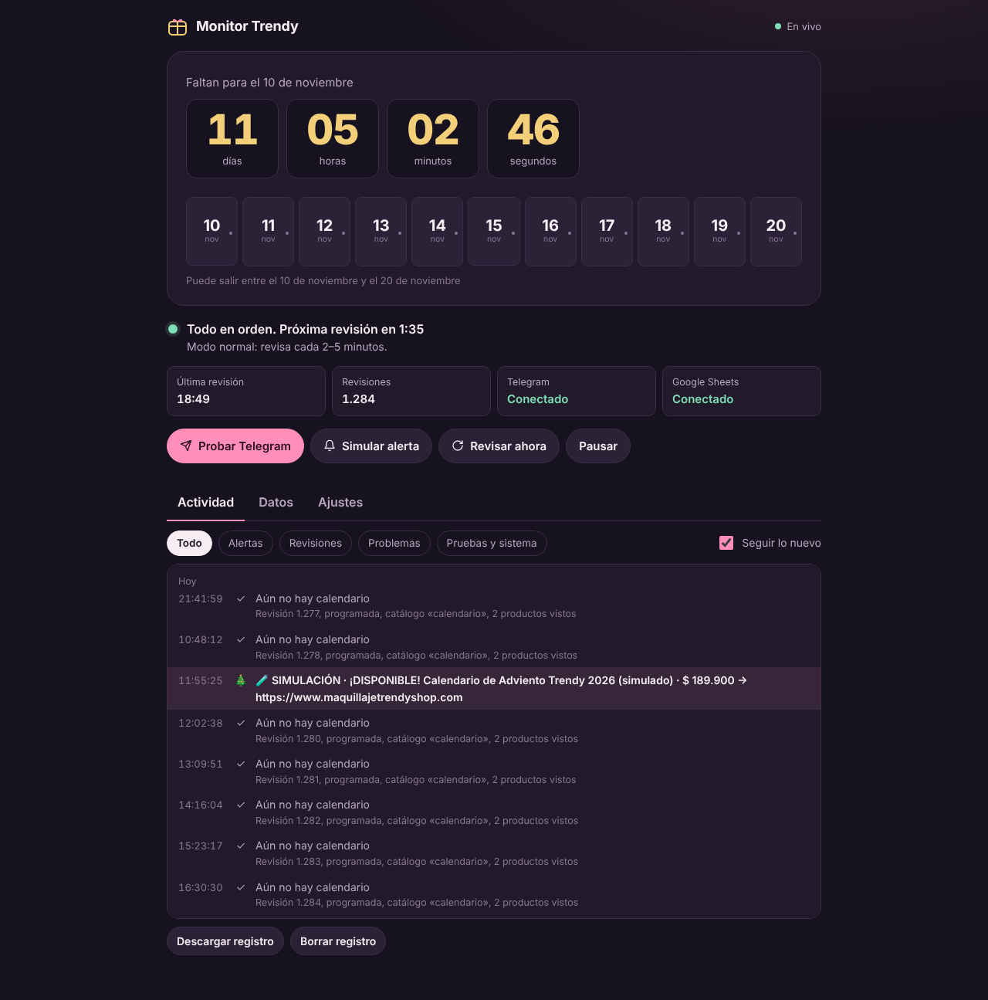
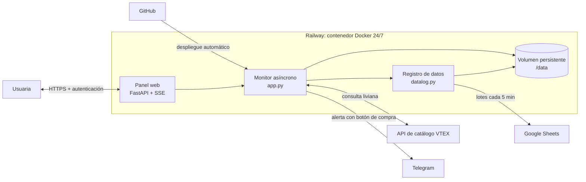

# Monitor Trendy

**Sistema de monitoreo en tiempo real que detecta el lanzamiento de un producto de edición limitada y avisa al celular en menos de dos minutos, mientras construye su propio dataset para análisis.**

Python · FastAPI · asyncio · API REST de VTEX · Telegram Bot API · Docker · Railway · Google Apps Script · Excel



---

## El problema

El Calendario de Adviento de Trendy (tienda colombiana de maquillaje) sale en una fecha no anunciada entre el 10 y el 20 de noviembre y se agota en minutos. Revisar la tienda a mano durante 11 días no es viable.

**La solución:** un servicio en la nube que consulta el catálogo de la tienda las 24 horas, detecta el momento exacto en que el producto aparece con stock y envía una alerta a Telegram con un botón que **abre el checkout con el producto ya en el carrito**. Cada consulta queda registrada como una fila de datos, lo que convierte el monitor en una fuente de datos propia.

## Qué hace

- **Detección en ~1–2 minutos** durante la ventana de lanzamiento, sin intervención humana y con el computador apagado.
- **Alertas accionables:** nombre, precio, unidades disponibles y un botón *Agregar al carrito y pagar* que usa el enlace oficial de checkout de VTEX.
- **Tres modos adaptativos** que cambian solos según la fecha y lo que encuentra la tienda (normal, lanzamiento y turbo).
- **Pipeline de datos:** 20 variables por consulta, exportables a Excel o CSV y sincronizadas con Google Sheets.
- **Panel web en tiempo real** con cuenta regresiva, registro de actividad en vivo, configuración y botones de prueba de extremo a extremo.
- **Monitoreo del propio monitor:** latido cada 6 horas, alertas de errores y endpoint de salud.

## Arquitectura



Cada revisión sigue el mismo ciclo: espera un tiempo aleatorio → elige una consulta → consulta VTEX → registra la fila → decide si encontró el producto y si tiene stock → avisa.

## Decisiones de ingeniería

**Consultar la API, no la página.** La tienda corre sobre VTEX, que expone una API pública de catálogo. Cada consulta descarga 1–5 KB de JSON con el stock exacto (`AvailableQuantity`), en lugar de varios MB de HTML que además se romperían con cualquier rediseño.

**Carga mínima y tráfico de apariencia humana.** Cada revisión hace una sola consulta pequeña, alternando entre dos índices de búsqueda de VTEX. Los intervalos son aleatorios y la identidad del cliente varía. Durante un día completo de lanzamiento el monitor transfiere unos 5 MB, menos que una sola visita de una persona a la tienda.

**Frecuencia adaptativa en tres modos.**

| Modo | Se activa | Intervalo | Objetivo |
|---|---|---|---|
| Normal | Fuera de la ventana de lanzamiento | 2–5 min + jitter | Detectar publicaciones anticipadas |
| Lanzamiento | Entre las fechas configuradas | 50–100 s + jitter | Aviso en ~1–2 min |
| Turbo | El producto aparece sin stock (3 h) | ~30 s, consulta por ID | Captar la apertura de ventas |

**Concurrencia con asyncio.** Un solo proceso atiende el bucle de monitoreo, el panel en tiempo real, los envíos a Telegram y la sincronización con Sheets sin bloquearse entre sí. Las operaciones costosas (generar un Excel de miles de filas) corren en otro hilo.

**Tiempo real con Server-Sent Events.** El servidor empuja cada evento al panel. Se eligió SSE frente a *polling* (tráfico inútil y retraso) y frente a WebSockets (bidireccionales, innecesarios aquí). La cuenta regresiva corrige el reloj del dispositivo con la hora del servidor.

**Alertas idempotentes.** Cada producto guarda su estado de notificación en disco, así que nunca se repite un aviso, ni siquiera tras un reinicio. Si el producto se agota y lo reponen, el ciclo se reinicia y vuelve a avisar.

**Asistir la compra sin automatizarla.** El botón de la alerta usa el enlace oficial `/checkout/cart/add` de VTEX: abre el carrito en el navegador de la usuaria, con su sesión. El servidor nunca maneja datos de pago y la compra la confirma una persona, como exigen la verificación bancaria y los términos de la tienda.

## Confiabilidad

| Falla | Respuesta del sistema |
|---|---|
| Errores de la tienda (403, 429, 5xx) | *Backoff* progresivo con tope y alerta tras 5 errores seguidos; aviso de recuperación |
| Excepción inesperada en el bucle | Supervisor que lo reinicia en 10 s |
| Caída del contenedor | Política de reinicio y *healthcheck* en `railway.json` |
| Falla silenciosa (vivo pero sin revisar) | `/health` responde 503 y deja de llegar el latido de 6 h |
| Telegram o Google no responden | Reintentos con espera; las filas se encolan sin perderse |
| Redespliegue | Apagado ordenado que sincroniza lo pendiente antes de salir |
| Corte a mitad de escritura | Escrituras atómicas (archivo temporal + renombrado) |

Además: autenticación con comparación en tiempo constante, secretos en variables de entorno, límites de memoria en cada cola y escape de HTML en los mensajes.

## El dataset

Cada consulta HTTP a la tienda genera una fila con 20 variables:

| Grupo | Variables |
|---|---|
| Tiempo | fecha y hora, fecha, hora del día, día de la semana, segundos desde la consulta anterior |
| Contexto | número de revisión, motivo, modo |
| Origen | fuente de VTEX, término consultado |
| Respuesta | código HTTP, éxito (1/0), latencia (ms), tamaño (KB), error |
| Resultado | productos devueltos, coincidencias, con stock (1/0), unidades, precio |

El registro maestro es un CSV de solo-anexar. Se exporta a Excel con tipos reales y diccionario de datos, y se sincroniza por lotes con Google Sheets mediante un webhook de Apps Script protegido con token.

**Preguntas que responde:** latencia de la tienda por franja horaria, tasa de error por fuente, cuál índice de VTEX detectó primero el producto, tiempo entre publicación y disponibilidad, y si los intervalos siguen la distribución configurada.

## Estructura

```
├── app.py                   Monitor, lógica de detección, alertas y API del panel
├── datalog.py               Registro de consultas y exportación (CSV, Excel, Sheets)
├── static/index.html        Panel web (HTML + JavaScript sin dependencias)
├── google-sheets/Codigo.gs  Receptor de datos en Google Apps Script
├── Dockerfile               Imagen de producción
└── railway.json             Healthcheck y política de reinicio
```

## Ejecutar localmente

```bash
pip install -r requirements.txt
export TELEGRAM_BOT_TOKEN=... TELEGRAM_CHAT_ID=... PANEL_PASSWORD=...
uvicorn app:app --port 8000
```

Variables opcionales: `SHEETS_WEBHOOK_URL` y `SHEETS_TOKEN` para la sincronización con Google Sheets.

## Uso responsable

Proyecto personal y educativo. Solo consulta datos públicos de catálogo, con una carga inferior a la de una visita normal, y no automatiza compras: la decisión y el pago siempre los hace una persona.

---

**Jenniffer Duque** · Estudiante de Ingeniería de Software · Análisis de datos · [GitHub](https://github.com/JenniFFerDuque)
